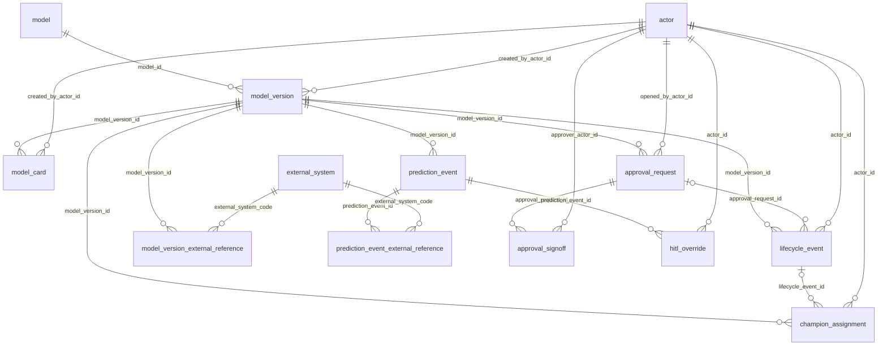

# mlgov metamodel specification

The governance data model for the piq-mlplatform lab: the schema that
tracks model versions, their lifecycle, deployment approvals, predictions,
and human feedback on those predictions. Implemented by
[mlgov_ddl.sql](mlgov_ddl.sql), which is the single source of this DDL —
applied identically to the local sandbox Postgres container and to AWS RDS.
This document describes what that file builds; if the two ever disagree,
the DDL file is authoritative and this document should be corrected to
match it.

Design lineage: a subset of table shapes and naming conventions selected
from the Verity governance platform (`github.com/anilvenugopal/verity`,
`specs/schema/`), adapted to this lab's scale — two trained models, not a
fleet of agents. Borrowed: the append-only lifecycle/champion pattern, the
model-card review-state pattern, the approval-request/signoff gating
pattern, the actor attribution model. Left out of this lab's scope:
Verity's Controls & Evidence (regulatory/compliance mapping) axis, Intake,
Asset Registry composition (prompts/tools/MCP/connectors), and Harness
Runtime (fleet execution) — those model a multi-application, multi-agent
platform; this lab governs two batch-trained models.

`actor` is a known open item, not yet redesigned — see
[9. Open items](#9-open-items).

---

## 1. Scope

`mlgov` is one of two schemas in the same PostgreSQL database (see
[2. Where this runs](#2-where-this-runs) for the local/AWS placement). The
other schema, `feast`, holds Feast's own registry tables, created and
managed by `feast apply`, not by this DDL. No foreign key in `mlgov`
crosses into `feast` — cross-schema references are held as typed pointers
(`*_external_reference` tables) or plain values
(`prediction_event.entity_id`), described in
[4. Key strategy](#4-key-strategy).

---

## 2. Where this runs

`mlgov_ddl.sql` runs against two environments over the life of this
project:

| Environment | Postgres instance | How this file is applied |
|---|---|---|
| Local sandbox | A Postgres 18 container (`mlops-sandbox/compose.yml`) | Mounted into the container and run automatically on first startup by `mlops-sandbox/postgres-init/01-bootstrap.sh`. |
| AWS | RDS PostgreSQL, `db.t4g.micro`, in `modules/metastore` (SETUP.md section 7.2) | Not yet wired up — `modules/metastore` is currently an empty module. When built, it should apply this same file rather than a copy of it. |

Both environments create the same two schemas (`feast`, `mlgov`) on the
same database instance, per SETUP.md section 2's architecture. Nothing in
this DDL file is environment-specific — there is no local-only or AWS-only
table, column, or constraint. The only things that differ by environment
are outside this file entirely: the Postgres host/port/credentials
(`mlops-sandbox/.env` locally, Terraform variables in `envs/lab` on AWS),
and the actual rows in `model_version_external_reference` /
`prediction_event_external_reference` that point at real SageMaker
resources (local development can simply have no rows for
`sagemaker_model_package` or `sagemaker_endpoint`, since there is no
SageMaker to point at until `modules/ml` exists).

---

## 3. Entity relationship diagram



`role`, `lifecycle_state`, `model_card_state`, `approval_request_status`,
and `approval_decision` are omitted from the diagram for legibility — every
`*_code` column in every table above references one of these five
reference tables by foreign key. They are listed in full in
[5. Reference tables](#5-reference-tables).

Note that `model_version_external_reference` and
`prediction_event_external_reference` carry the external system's key
(`external_key`) directly on the row — there is no separate pointer table
in between. Each links to its one owning table (`model_version` or
`prediction_event`) and to `external_system` for the controlled code list.
See [4. Key strategy](#4-key-strategy) for why.

---

## 4. Key strategy

Three distinct kinds of reference appear in this schema, and they are
handled three different ways on purpose:

1. **A row `mlgov` owns, referenced from another row `mlgov` owns** — a
   real foreign key, `uuid`, generated by `uuidv7()`. Example:
   `model_version.model_id → model.model_id`.
2. **A fact owned by SageMaker, Feast, or MLflow** — never copied into
   `mlgov` as a synced column. Held directly on
   `model_version_external_reference` (for facts about a `model_version`)
   or `prediction_event_external_reference` (for facts about a
   `prediction_event`): each row names which external system
   (`external_system_code`, a foreign key into the small `external_system`
   lookup table) and the native key in that system's own format
   (`external_key` — an ARN, an endpoint name, a feature service name, an
   MLflow `<registered_model_name>/<version>` string — stored verbatim as
   text). The primary key of both tables is `(owning_id,
   external_system_code)`, so a `model_version` or `prediction_event` has
   at most one row per external system, and can have zero, one, or
   several across different systems, without any change to
   `model_version`'s or `prediction_event`'s own schema.

   This design went through two earlier shapes during review, each
   rejected for a concrete reason worth recording:
   - **Named nullable columns directly on `model_version`**
     (`sagemaker_package_ref_id`, `feast_feature_service_ref_id`, ...) —
     rejected because every new external system (a JEV integration, a
     different inference platform) would require adding another column to
     `model_version` forever.
   - **A single shared `external_reference` lookup table**, attached to
     `model_version` and `prediction_event` through separate join tables
     — rejected because it added a second join to reach a value
     (`owning table → join table → external_reference`) for no benefit:
     the "reference" was never looked up or reused independently of the
     row that pointed at it, so the extra table was pure indirection. The
     fields that lived on that table — `external_system_code` and
     `external_key` — belong directly on the table that uses them.
3. **The Feast entity key scored by a prediction** —
   `prediction_event.entity_id`, a direct `text` column, with no
   indirection through `external_system`/`external_key` at all. This is
   a deliberate further exception: `entity_id` is present on every row of
   the schema's highest-volume table, not an occasional or optional fact,
   and `prediction_event` is expected to be queried by entity constantly
   (see its index, `ix_prediction_event_entity`). There is nothing else
   about the entity that `mlgov` needs to record beyond which one was
   scored, so a typed lookup row would add a join with no second fact to
   justify it.

`mlgov` does not sync or cache facts from SageMaker, Feast, or MLflow
under any of these three rules. A `model_version`'s framework, training
job ARN, container image, or evaluation metrics live in SageMaker Model
Registry and are read from there directly; a `model_version`'s feature
schema lives in the Feast registry and is read from there directly; a
`model_version`'s training parameters and metrics live in MLflow and are
read from there directly. `mlgov` holds only enough to look the right
record up.

---

## 5. Reference tables

Five small lookup tables, each `(code, label, description[, sort_order])`,
seeded with their full value set by this DDL file (not left for an
application to populate). Every other table's `*_code` columns are foreign
keys into one of these.

### `role`

The capacity an actor acts in on a given row.

| Column | Type | Notes |
|---|---|---|
| `code` | text, PK | |
| `label` | text | |
| `description` | text | nullable |

Seeded values: `ml_engineer`, `governance_approver`, `adjuster`, `system`.

### `lifecycle_state`

The progression a `model_version` moves through. Five states — Verity's
six-state list without `challenger`, which is an A/B run-mode concept for
agentic systems this lab does not use.

| Column | Type | Notes |
|---|---|---|
| `code` | text, PK | |
| `label` | text | |
| `description` | text | nullable |
| `sort_order` | integer, unique | defines the progression order |

Seeded values, in order: `draft`, `candidate`, `staging`, `champion`,
`deprecated`.

### `model_card_state`

The review state of a `model_card`, tracked separately from the
`model_version`'s own `lifecycle_state` — a card can be `in_review` while
its version is still `draft`.

| Column | Type | Notes |
|---|---|---|
| `code` | text, PK | |
| `label` | text | |
| `description` | text | nullable |
| `sort_order` | integer, unique | |

Seeded values, in order: `draft`, `in_review`, `approved`, `superseded`.

### `approval_request_status`

The mutable current state of an `approval_request`. This is the one
intentionally mutable status column in the schema — see
[6.8 `approval_request`](#68-approval_request) for why.

| Column | Type | Notes |
|---|---|---|
| `code` | text, PK | |
| `label` | text | |
| `description` | text | nullable |
| `sort_order` | integer, unique | |

Seeded values, in order: `pending`, `approved`, `rejected`, `withdrawn`.

### `approval_decision`

An individual approver's decision on one `approval_signoff` row.

| Column | Type | Notes |
|---|---|---|
| `code` | text, PK | |
| `label` | text | |
| `description` | text | nullable |

Seeded values: `approve`, `reject`.

### `external_system`

The systems `mlgov` points into without owning their data. Adding support
for a new external system (a JEV endpoint, an MCP server, a different
inference platform) is a new row here, not a new column anywhere else.

| Column | Type | Notes |
|---|---|---|
| `code` | text, PK | |
| `label` | text | |
| `description` | text | nullable |

Seeded values: `sagemaker_model_package`, `sagemaker_endpoint`,
`feast_feature_service`, `mlflow_model_version`.

---

## 6. Core tables

### 6.1 `actor`

The single attribution principal for the schema — one identity for humans
and automation alike. Every auditable row in `mlgov` carries an
`actor_id` plus the `role` it acted in, so "who did this, in what
capacity" resolves the same way everywhere.

| Column | Type | Nullable | Notes |
|---|---|---|---|
| `actor_id` | uuid, PK | no | `uuidv7()` |
| `display_name` | text | no | checked non-blank |
| `is_active` | boolean | no | default `true`; deactivating fails closed without deleting past attribution |
| `created_at` | timestamptz | no | default `now()` |

No foreign keys out of this table. Referenced by `model_version`,
`lifecycle_event`, `champion_assignment`, `model_card`,
`approval_request`, `approval_signoff`, and `hitl_override`, each pairing
an `actor_id` with an `acting_role_code` / `created_role_code` /
`opened_role_code` (all → `role`).

**`display_name` is a known gap, not a finished design** — see
[9. Open items](#9-open-items). It records a free-text name and nothing
about what kind of actor this is (a human, tied to some identity system;
an automated process) or which system actually manages that identity. The
fix was scoped during review but deliberately deferred rather than
designed under time pressure.

### 6.2 `model_version_external_reference`

A typed pointer from a `model_version` into a system `mlgov` does not own.
See [4. Key strategy](#4-key-strategy) for the reasoning and the two
earlier, rejected shapes this table replaced.

| Column | Type | Nullable | Notes |
|---|---|---|---|
| `model_version_id` | uuid, FK → `model_version.model_version_id` | no | part of the primary key |
| `external_system_code` | text, FK → `external_system.code` | no | part of the primary key |
| `external_key` | text | no | native key in the external system, verbatim |
| `created_at` | timestamptz | no | default `now()` |

Primary key is `(model_version_id, external_system_code)` — at most one
row per external system per version. The foreign key to `model_version`
is added by an `ALTER TABLE` statement after `model_version` is created
later in the file (the same forward-reference pattern used for
`lifecycle_event → approval_request`), since this table is defined
immediately after `actor`, before `model` or `model_version` exist yet.

### 6.3 `prediction_event_external_reference`

A typed pointer from a `prediction_event` into a system `mlgov` does not
own — typically the SageMaker endpoint that served it.

| Column | Type | Nullable | Notes |
|---|---|---|---|
| `prediction_event_id` | uuid, FK → `prediction_event.prediction_event_id` | no | part of the primary key |
| `external_system_code` | text, FK → `external_system.code` | no | part of the primary key |
| `external_key` | text | no | native key in the external system, verbatim |
| `created_at` | timestamptz | no | default `now()` |

Same shape as `model_version_external_reference`. The foreign key to
`prediction_event` is added by a later `ALTER TABLE` statement for the
same file-ordering reason.

### 6.4 `model`

Identity only. Deliberately kind-agnostic: no SageMaker/Feast pointers, no
version-specific fields, no fields specific to how the model is hosted or
invoked. Every row today is a trained ML model
(`total-loss-fnol`, `claim-severity`); the table's shape does not need to
change for a future model kind (an LLM-backed model, or TypeSafe AI's JEV)
to register here too. What varies by version lives on `model_version`;
what would vary by kind would live in a kind-specific detail table keyed
off `model_version`, introduced when a second kind exists to design it
against.

| Column | Type | Nullable | Notes |
|---|---|---|---|
| `model_id` | uuid, PK | no | `uuidv7()` |
| `name` | text, unique | no | e.g. `total-loss-fnol` |
| `description` | text | yes | |
| `created_at` | timestamptz | no | default `now()` |

### 6.5 `model_version`

An immutable version of a `model`. Every other table in this schema that
concerns a specific model points at a `model_version`, never at the bare
`model` — `lifecycle_event`, `champion_assignment`, `model_card`,
`approval_request`, `model_version_external_reference`, and (via
`prediction_event`) `hitl_override`.

| Column | Type | Nullable | Notes |
|---|---|---|---|
| `model_version_id` | uuid, PK | no | `uuidv7()` |
| `model_id` | uuid, FK → `model.model_id` | no | |
| `major` | integer | no | part of the version identity — see below |
| `minor` | integer | no | default `0` |
| `patch` | integer | no | default `0` |
| `version_label` | text | yes | optional display string, e.g. a release codename |
| `created_at` | timestamptz | no | default `now()` |
| `created_by_actor_id` | uuid, FK → `actor.actor_id` | no | |
| `created_role_code` | text, FK → `role.code` | no | |

`UNIQUE (model_id, major, minor, patch)` — a version's identity is its
semver triple, not `version_label`. This replaced an earlier design where
`version_label` was the only versioning field and carried the uniqueness
constraint: a free-text label (`"v3"` one time, `"3.0"` another) has no
defined ordering and no guard against two different versions accidentally
sharing a label with different formatting. `major`/`minor`/`patch` are
each checked non-negative (`ck_model_version_major_nonneg` and so on).
`version_label` remains available for a human-facing display string, but
carries no uniqueness or ordering guarantee of its own.

`model_version` carries no columns pointing at SageMaker, Feast, or
MLflow — those relationships are attached via
[`model_version_external_reference`](#62-model_version_external_reference)
instead. See [4. Key strategy](#4-key-strategy) for why.

### 6.6 `lifecycle_event`

The append-only state machine for a `model_version`. There is no mutable
"current state" column anywhere in this schema; current state is always
resolved from the latest row here by the view
[`model_lifecycle_current`](#71-model_lifecycle_current).

| Column | Type | Nullable | Notes |
|---|---|---|---|
| `lifecycle_event_id` | uuid, PK | no | `uuidv7()` |
| `model_version_id` | uuid, FK → `model_version.model_version_id` | no | |
| `from_state_code` | text, FK → `lifecycle_state.code` | yes | null only on a version's first event |
| `to_state_code` | text, FK → `lifecycle_state.code` | no | |
| `approval_request_id` | uuid, FK → `approval_request.approval_request_id` | yes | the gating approval, when the transition required one |
| `rationale` | text | no | why the transition was made — a required audit fact |
| `actor_id` | uuid, FK → `actor.actor_id` | no | |
| `acting_role_code` | text, FK → `role.code` | no | |
| `created_at` | timestamptz | no | default `now()` |

`CHECK (from_state_code IS NULL OR from_state_code <> to_state_code)` — a
row can never claim a transition from a state to itself.

The foreign key to `approval_request` is added by an `ALTER TABLE`
statement after `approval_request` is created later in the same DDL file,
since `approval_request` also references `model_version` and the two
tables would otherwise need to exist simultaneously to reference each
other. This is a file-ordering detail, not a statement about how common
gated transitions are — most transitions (e.g. `draft → candidate`) are
expected to carry no `approval_request_id`; only a transition that
actually requires the gate does.

Whether a transition into `champion` is required to carry a non-null
`approval_request_id` is not enforced by a database constraint at this
lab's scale; it is an application-level rule.

### 6.7 `champion_assignment`

The append-only champion pointer: assign and revoke events. There is no
mutable `is_champion` flag; the current champion is resolved from the
latest row here by the view
[`model_champion_current`](#72-model_champion_current).

| Column | Type | Nullable | Notes |
|---|---|---|---|
| `champion_assignment_id` | uuid, PK | no | `uuidv7()` |
| `model_version_id` | uuid, FK → `model_version.model_version_id` | no | |
| `is_revocation` | boolean | no | default `false`; `true` demotes rather than promotes |
| `lifecycle_event_id` | uuid, FK → `lifecycle_event.lifecycle_event_id` | yes | the promotion transition that produced this assignment, when there is one |
| `reason` | text | yes | |
| `actor_id` | uuid, FK → `actor.actor_id` | no | |
| `acting_role_code` | text, FK → `role.code` | no | |
| `created_at` | timestamptz | no | default `now()` |

Index: `(model_version_id, created_at DESC)`, supporting the "latest row
for this version" lookup the resolving view depends on.

### 6.8 `model_card`

The documentation artifact for a `model_version`: content plus its own
review state, distinct from the version's `lifecycle_state`. This is the
table the deployment gate reads: a promotion to `champion` is expected to
check that specific fields inside `content` (owner, PII classification,
intended use, known limitations) are present before the gate passes.

| Column | Type | Nullable | Notes |
|---|---|---|---|
| `model_card_id` | uuid, PK | no | `uuidv7()` |
| `model_version_id` | uuid, FK → `model_version.model_version_id` | no | |
| `model_card_state_code` | text, FK → `model_card_state.code` | no | default `draft` |
| `content` | jsonb | no | the card itself |
| `created_at` | timestamptz | no | default `now()` |
| `updated_at` | timestamptz | no | default `now()` |
| `created_by_actor_id` | uuid, FK → `actor.actor_id` | no | |
| `created_role_code` | text, FK → `role.code` | no | |

Which fields `content` must contain for the deployment gate to pass is
validated at the application layer — not expressed as a JSON-schema
`CHECK` constraint in this DDL, at this lab's scale.

### 6.9 `approval_request`

A gating request to promote a `model_version` to `target_state_code` —
in practice, almost always `champion`. `status_code` is the one
intentionally mutable column in this schema: a request's status has no
meaningful history beyond its individual sign-offs, which are themselves
append-only in `approval_signoff`, so there is nothing an event-sourced
table would preserve that isn't already preserved there.

| Column | Type | Nullable | Notes |
|---|---|---|---|
| `approval_request_id` | uuid, PK | no | `uuidv7()` |
| `model_version_id` | uuid, FK → `model_version.model_version_id` | no | |
| `target_state_code` | text, FK → `lifecycle_state.code` | no | the state this request would promote to |
| `status_code` | text, FK → `approval_request_status.code` | no | default `pending`; the mutable column |
| `opened_by_actor_id` | uuid, FK → `actor.actor_id` | no | |
| `opened_role_code` | text, FK → `role.code` | no | |
| `created_at` | timestamptz | no | default `now()` |
| `updated_at` | timestamptz | no | default `now()` |

Index: `status_code`, supporting "find all pending requests."

This table is a simplification of Verity's general-purpose
`approval_request`, which targets one of several unrelated entity kinds
(an intake, an executable version, an application onboarding) through an
exclusive-arc set of nullable foreign keys. `mlgov` only ever gates a
`model_version` promotion, so `model_version_id` is a single, direct,
non-nullable foreign key rather than an exclusive arc.

### 6.10 `approval_signoff`

One immutable per-approver decision on an `approval_request`.

| Column | Type | Nullable | Notes |
|---|---|---|---|
| `approval_signoff_id` | uuid, PK | no | `uuidv7()` |
| `approval_request_id` | uuid, FK → `approval_request.approval_request_id` | no | |
| `approver_actor_id` | uuid, FK → `actor.actor_id` | no | |
| `signed_as_role_code` | text, FK → `role.code` | no | the required role this sign-off fills |
| `decision_code` | text, FK → `approval_decision.code` | no | |
| `comment` | text | yes | |
| `created_at` | timestamptz | no | default `now()` |

`UNIQUE (approval_request_id, signed_as_role_code)` — one sign-off per
required role per request; this is how a multi-role quorum would be
counted if this lab's approval process ever required more than the single
`governance_approver` role it uses today. Index: `approval_request_id`.

### 6.11 `prediction_event`

Every scored prediction — named `mlgov.prediction_event` to match
SETUP.md section 9.4's expectation exactly ("Prediction lands in
`mlgov.prediction_event` with entity keys and as-of timestamp").

| Column | Type | Nullable | Notes |
|---|---|---|---|
| `prediction_event_id` | uuid, PK | no | `uuidv7()` |
| `model_version_id` | uuid, FK → `model_version.model_version_id` | no | |
| `entity_id` | text | no | the Feast entity key scored, e.g. a `claim_id` — direct column, see [4. Key strategy](#4-key-strategy) |
| `decision` | jsonb | no | the model output as served, e.g. `{"is_total_loss": true, "score": 0.83}` |
| `scored_at` | timestamptz | no | when inference actually ran |
| `features_as_of` | timestamptz | no | the as-of timestamp used for the point-in-time feature lookup |
| `created_at` | timestamptz | no | default `now()` |

`decision` is `jsonb` rather than typed columns so the total-loss
classifier and the severity regressor share this one table despite having
differently-shaped outputs. The SageMaker endpoint that served a
prediction, when there is one, is a row in
[`prediction_event_external_reference`](#63-prediction_event_external_reference)
rather than a column here — no endpoint, e.g. for a backtest, simply means
no row exists in that table for this prediction.

`scored_at` and `features_as_of` are distinct facts: `features_as_of` is a
feature-freshness fact (which point-in-time feature values were read),
`scored_at` is when the inference call itself ran. They are not always the
same moment.

Indexes: `(entity_id, scored_at DESC)` for "show me the prediction history
for this claim," and `(model_version_id, scored_at DESC)` for "show me
what this model version has predicted, in order." This table is expected
to be the highest-volume table in the schema — one row per scored claim —
though it is not physically partitioned at this lab's scale.

### 6.12 `hitl_override`

An additive, per-field human correction to a `prediction_event`. A
`hitl_override` row is neither a model input nor ground truth — it is a
human reviewer's opinion, captured at the moment they disagree with a
prediction, before anyone has verified whether the reviewer or the model
was right. (The parallel concept on the synthetic-data side is documented
in `data_generator/DATA_DICTIONARY.md`, "The three roles a table plays.")
Once a model is actually live, real adjuster overrides land here, against
real `prediction_event` rows; the data generator's synthetic
`adjuster_decision` table stands in for this same concept before any model
is actually deployed.

| Column | Type | Nullable | Notes |
|---|---|---|---|
| `hitl_override_id` | uuid, PK | no | `uuidv7()` |
| `prediction_event_id` | uuid, FK → `prediction_event.prediction_event_id` | no | |
| `field_path` | text | no | which field of `decision` was overridden, e.g. `is_total_loss` |
| `original_value` | jsonb | yes | the model's value before the override |
| `override_value` | jsonb | no | the human-supplied replacement |
| `reason` | text | no | free-text justification — required |
| `reason_code_family` | text | yes | coarse attribution: `feature` \| `model` \| `process`, matching `data_generator/config.yaml`'s `adjuster.reason_mix` taxonomy |
| `actor_id` | uuid, FK → `actor.actor_id` | no | the human who made the correction |
| `acting_role_code` | text, FK → `role.code` | no | |
| `created_at` | timestamptz | no | default `now()` |

Overrides never mutate the `prediction_event` row they correct; they are
appended as their own audited facts alongside it. Index:
`prediction_event_id`.

---

## 7. Views

Both views follow the same shape: `SELECT DISTINCT ON (...) ... ORDER BY
..., created_at DESC` over an append-only event table, resolving "current
state" without ever storing a mutable current-state column.

### 7.1 `model_lifecycle_current`

```sql
SELECT DISTINCT ON (model_version_id)
    model_version_id,
    to_state_code AS current_state_code,
    created_at    AS since
FROM mlgov.lifecycle_event
ORDER BY model_version_id, created_at DESC;
```

One row per `model_version_id` that has at least one `lifecycle_event`
row: its current state and the timestamp it entered that state.

### 7.2 `model_champion_current`

```sql
SELECT DISTINCT ON (model_version_id)
    model_version_id,
    is_revocation,
    created_at AS since
FROM mlgov.champion_assignment
ORDER BY model_version_id, created_at DESC;
```

One row per `model_version_id` that has at least one
`champion_assignment` row: whether its latest assignment event is a live
assignment (`is_revocation = false`) or a revocation
(`is_revocation = true`).

This view resolves state per `model_version_id`, not per `model_id`. To
find the current champion *model_version* for a given *model* (the
question "what is this model's champion right now"), join this view back
to `model_version.model_id` and filter to
`is_revocation = false` — the view alone answers "is this specific
version currently the champion," not "which version is the champion for
this model."

---

## 8. A full promotion sequence

Illustrative, not a stored procedure — this is the sequence of inserts an
application would make to move a `model_version` from `draft` to
`champion`, referencing the tables above:

1. `INSERT INTO model_version` — register the version (`major`/`minor`/
   `patch`, not just a label). Once `modules/ml` exists, this is typically
   followed by `INSERT INTO model_version_external_reference` with
   `external_system_code = 'sagemaker_model_package'` and the model
   package ARN as `external_key`.
2. `INSERT INTO lifecycle_event` — `from_state_code = NULL`,
   `to_state_code = 'draft'`.
3. `INSERT INTO model_card` — the documentation, `model_card_state_code =
   'draft'`.
4. `INSERT INTO lifecycle_event` — `draft → candidate`.
5. `INSERT INTO approval_request` — `target_state_code = 'champion'`,
   `status_code = 'pending'`.
6. `INSERT INTO approval_signoff` — the `governance_approver`'s decision.
   If the model card is missing a required field, the application layer
   refuses to let this insert happen with `decision_code = 'approve'` —
   this is the deployment gate SETUP.md's demo move 5 describes ("try to
   promote a model with an incomplete inventory row, watch the deploy
   fail, fill the field, watch it pass").
7. `UPDATE approval_request SET status_code = 'approved'` — once quorum
   (here, the single required sign-off) is met.
8. `INSERT INTO lifecycle_event` — `candidate → staging →` (further
   events) `→ champion`, the final one carrying
   `approval_request_id` pointing at step 5's row.
9. `INSERT INTO champion_assignment` — `is_revocation = false`,
   `lifecycle_event_id` pointing at step 8's final row.

From this point, `model_lifecycle_current` reports this version's state as
`champion`, and `model_champion_current` reports it as the live
(non-revoked) assignment for its `model_id`.

---

## 9. Open items

Raised during review, scoped, and deliberately deferred rather than
designed under time pressure. Tracked here so they are not lost.

- **`actor` needs real subtypes.** `display_name` alone does not say
  whether an actor is a human or an automated process, nor which system
  actually manages that identity (an identity provider, a local user
  registry, a named process). The agreed direction is a thin `actor`
  supertype plus `account_user` / `automation_actor` subtype tables
  (sharing `actor_id` as both primary and foreign key, the same pattern
  Verity uses) — deferred rather than designed now because this lab has
  no real identity-provider integration yet (no Entra, no multi-system
  auth), and designing the subtype tables' identity columns against a
  system that does not exist here would mean guessing. Revisit when an
  actual identity source exists to design against.
